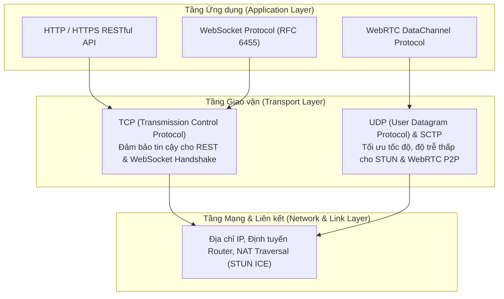
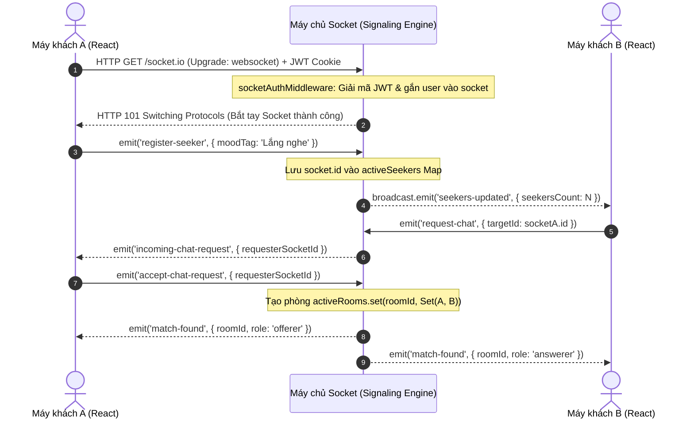
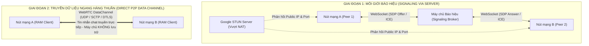
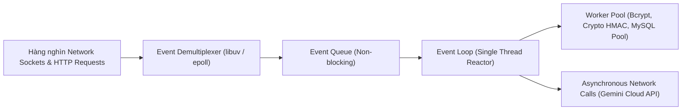
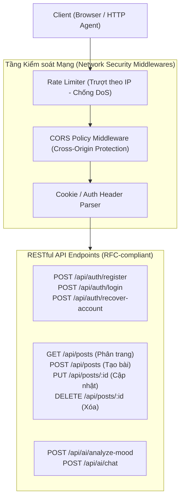
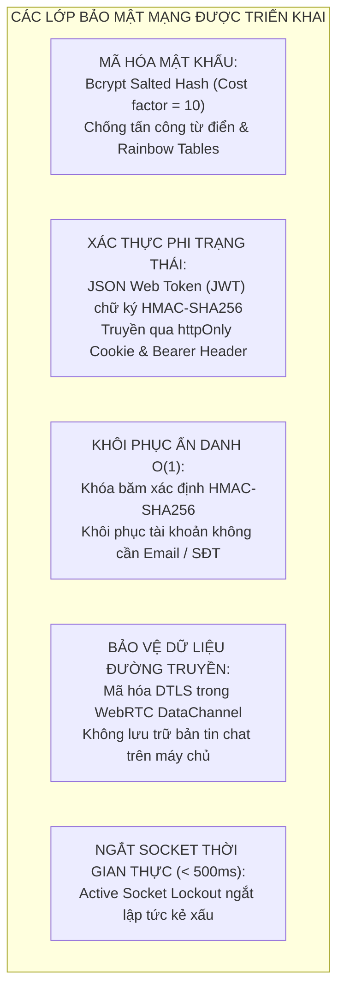
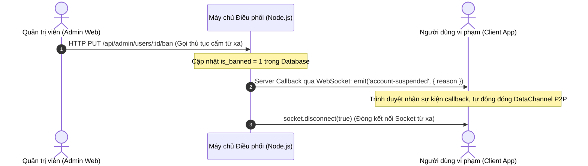
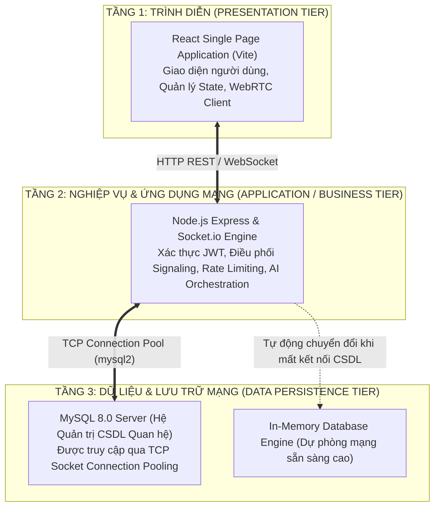
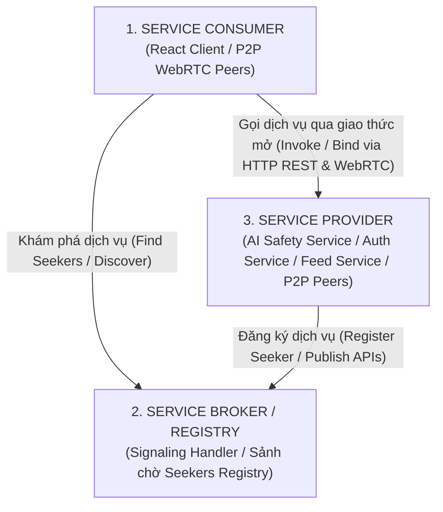
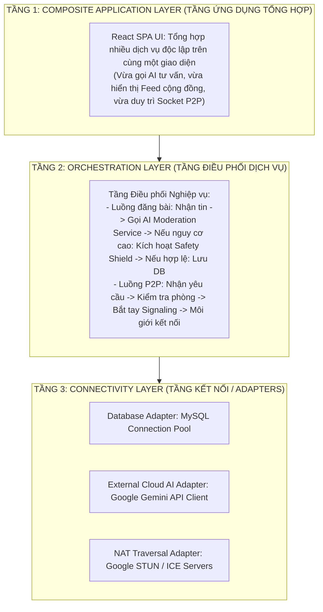

# 🌐 HỒ SƠ MINH CHỨNG KỸ THUẬT: ĐỐI CHIẾU ĐỒ ÁN VỚI HỌC PHẦN LẬP TRÌNH MẠNG (VKU)
## ĐỀ TÀI: HỆ THỐNG CHIA SẺ TÂM SỰ ẨN DANH HYBRID P2P & TRỢ LÝ AI AN TOÀN (HELI)

---

> **Tài liệu này được biên soạn nhằm:**
> 1. Chứng minh tính đúng đắn và chuẩn xác của đề tài theo đề cương chi tiết học phần **Lập trình Mạng** tại Trường Đại học Công nghệ Thông tin và Truyền thông Việt - Hàn (**VKU**).
> 2. Đối chiếu toàn diện từng bài giảng lý thuyết (từ **Bài 1 đến Bài 9**) và **Thang điểm đánh giá của Giảng viên** trực tiếp vào các module mã nguồn (`source code`) của hệ thống.
> 3. Cung cấp luận điểm kỹ thuật và kịch bản demo trực quan để bảo vệ đồ án trước Giảng viên hướng dẫn và Hội đồng chấm đồ án.

---

## 📑 MỤC LỤC
1. [Tuyên ngôn Kiến trúc: Tại sao đây là Hệ thống Lập trình Mạng nâng cao?](#1-tuyen-ngon-kien-truc)
2. [Bản đồ Ánh xạ Toàn diện 9 Bài giảng Môn Lập trình Mạng vào Source Code](#2-ban-do-anh-xa-9-bai-giang)
   - [Bài 1: Tổng quan Mạng máy tính & Mô hình Phân tầng (OSI & TCP/IP)](#bai-1-tong-quan-va-mo-hinh-phan-tang)
   - [Bài 2: Lập trình Socket & Luồng truyền thông (Socket Programming)](#bai-2-lap-trinh-socket)
   - [Bài 3: Kiến trúc Ứng dụng Mạng & Mạng Ngang Hàng (P2P - Peer-to-Peer)](#bai-3-kien-truc-mang-va-p2p)
   - [Bài 4: Xử lý Đa nhiệm & Bất đồng bộ trong Mạng (Concurrency & Async I/O)](#bai-4-xu-ly-da-nhiem-va-bat-dong-bo)
   - [Bài 5: Giao thức Tầng Ứng dụng & RESTful API (Application Protocols)](#bai-5-giao-thuc-tang-ung-dung)
   - [Bài 6: An toàn & Bảo mật Truyền thông Mạng (Network Security & Cryptography)](#bai-6-an-toan-va-bao-mat-mang)
   - [Bài 7: Triệu gọi Phương thức Từ xa & Dịch vụ Mạng (RMI / RPC / Web Services)](#bai-7-trieu-goi-phuong-thuc-tu-xa)
   - [Bài 8: Cơ sở Dữ liệu Mạng & Mô hình 3 Tầng CSDL (3-Tier Database)](#bai-8-co-so-du-lieu-mang-3-tang)
   - [Bài 9: Kiến trúc Hướng Dịch vụ (SOA - Service-Oriented Architecture)](#bai-9-kien-truc-huong-dich-vu-soa)
3. [Bảng Ma trận Đối chiếu Mã nguồn (Source Code Alignment Matrix)](#3-bang-ma-tran-doi-chieu)
4. [Kịch bản Demo Kỹ thuật Mạng trước Hội đồng (Live Network Demo)](#4-kich-ban-demo-ky-thuat-mang)
5. [Bộ Câu hỏi & Trả lời Phản biện (Q&A Defense Guide)](#5-bo-cau-hoi-va-tra-loi-phan-bien)

---

## 1. 🎯 TUYÊN NGÔN KIẾN TRÚC: TẠI SAO ĐÂY LÀ HỆ THỐNG LẬP TRÌNH MẠNG NÂNG CAO?

Nhiều người khi nhìn qua giao diện có thể nhầm tưởng đây là một "ứng dụng web thông thường" (Web CRUD). Tuy nhiên, **về bản chất kỹ thuật sâu bên trong**, đây là một **Hệ thống Mạng Phân tán (Distributed Network System)** giải quyết các bài toán cốt lõi của môn Lập trình Mạng:

| Tiêu chí | Ứng dụng Web / App thông thường | Hệ thống Lập trình Mạng HELI (Đồ án) |
| :--- | :--- | :--- |
| **Giao thức mạng** | Chỉ dùng HTTP Request / Response đơn tuyến, hỏi gì đáp nấy. | Kết hợp đa giao thức: **HTTP/1.1 REST**, **WebSocket (RFC 6455)** 2 chiều, và **WebRTC (SCTP/DTLS/UDP)** ngang hàng. |
| **Kiến trúc mạng** | Client - Server tập trung đơn thuần (Monolithic). Dữ liệu dồn hết vào máy chủ. | **Mô hình Lai (Hybrid P2P & SOA 3 tầng)**: Server làm Broker môi giới, Client kết nối trực tiếp với nhau. |
| **Xử lý truyền thông** | Lưu mọi tin nhắn vào Database máy chủ (Nguy cơ rò rỉ dữ liệu, vi phạm quyền riêng tư). | **P2P DataChannel không lưu log**: Dữ liệu chat truyền thẳng giữa 2 máy khách trong bộ nhớ RAM, máy chủ không lưu bất kỳ byte tin nhắn nào. |
| **Vượt rào cản mạng** | Không xử lý được bài toán NAT / Firewall giữa các máy khách. | Tích hợp **STUN / ICE Protocol** để giải quyết bài toán NAT Traversal giữa các nút mạng ở các mạng con khác nhau. |
| **Phân tán dịch vụ** | Code dồn cục một chỗ (Chặt chẽ - Tightly coupled). | **Kiến trúc Hướng dịch vụ (SOA)**: Tách biệt Service Provider, Service Consumer, Service Broker, và tầng Orchestration điều phối. |

> **Khẳng định:** Đồ án không dừng lại ở mức "lập trình giao diện web", mà ứng dụng toàn bộ kiến thức nền tảng của Lập trình Mạng để xây dựng kênh truyền thông thời gian thực, môi giới ngang hàng và bảo mật dữ liệu trên đường truyền.

---

## 2. 🗺️ BẢN ĐỒ ÁNH XẠ TOÀN DIỆN 9 BÀI GIẢNG VÀO SOURCE CODE

---

### 📍 BÀI 1: TỔNG QUAN MẠNG MÁY TÍNH & MÔ HÌNH PHÂN TẦNG (OSI & TCP/IP)

Hệ thống triển khai đầy đủ ngăn xếp giao thức mạng theo mô hình **TCP/IP 4 tầng** và **OSI 7 tầng**:

* **Ứng dụng thực tế trong đồ án**:
  - Tầng Transport sử dụng **TCP** cho luồng xác thực, quản lý bài viết và bắt tay Socket (đảm bảo không mất gói tin).
  - Tầng Transport sử dụng **UDP/SCTP** cho luồng P2P DataChannel qua WebRTC (đảm bảo độ trễ gần như bằng 0 khi người dùng trò chuyện ẩn danh).
  - Sử dụng **STUN Server** của Google (`stun:stun.l.google.com:19302`) tại tầng mạng để giải mã địa chỉ Public IP và Port đằng sau các lớp NAT/Router gia đình.
* **Minh chứng mã nguồn**:
  - Cấu hình máy chủ HTTP/TCP: [`server/src/server.js`](file:///d:/DACS4/server/src/server.js#L21-L31)
  - Cấu hình STUN máy chủ tầng mạng: [`server/src/config/iceServers.js`](file:///d:/DACS4/server/src/config/iceServers.js#L1-L7) và [`server/src/config/env.js`](file:///d:/DACS4/server/src/config/env.js#L48-L51)

---

### 📍 BÀI 2: LẬP TRÌNH SOCKET & LUỒNG TRUYỀN THÔNG (SOCKET PROGRAMMING)

Bài 2 giảng dạy về cơ chế kết nối 2 chiều liên tục qua Socket. Hệ thống sử dụng engine **Socket.io / WebSocket (RFC 6455)** với các kỹ thuật lập trình Socket mạng nâng cao:

* **Các kỹ thuật Socket được áp dụng**:
  1. **Bắt tay và Nâng cấp Giao thức (Handshake & Protocol Upgrade)**: Bắt đầu từ HTTP Request với header `Connection: Upgrade`, máy chủ chuyển đổi sang giao thức WebSocket nhị phân hai chiều.
  2. **Xác thực kết nối Socket ngay tại tầng Handshake**: Middleware [`socketAuthMiddleware`](file:///d:/DACS4/server/src/middleware/socketAuth.js#L1-L40) chặn ngay các kết nối socket không có token hoặc token hết hạn trước khi cho phép vào hệ thống.
  3. **Quản lý không gian tên & Phòng phân luồng (Namespaces & Dynamic Rooms)**: Sử dụng `socket.join(roomId)` để gom 2 máy khách vào một phòng truyền thông bảo mật, dùng `verifyRoomMembership(roomId)` ngăn chặn tấn công giả mạo can thiệp vào phòng chat của người khác.
  4. **Quản lý Vòng đời Kết nối (Connection Lifecycle & Graceful Cleanup)**: Bắt sự kiện `disconnect`, tự động dọn dẹp hàng đợi `waitingQueue`, xóa khỏi danh sách người chờ `activeSeekers`, và phát sự kiện `peer-disconnected` để đối phương đóng kết nối an toàn.
* **Minh chứng mã nguồn**:
  - Khởi tạo Socket.io Server: [`server/src/server.js`](file:///d:/DACS4/server/src/server.js#L24-L31)
  - Xác thực Socket Handshake: [`server/src/middleware/socketAuth.js`](file:///d:/DACS4/server/src/middleware/socketAuth.js)
  - Bộ xử lý sự kiện truyền thông Socket: [`server/src/sockets/signalingHandler.js`](file:///d:/DACS4/server/src/sockets/signalingHandler.js#L140-L476)

---

### 📍 BÀI 3: KIẾN TRÚC ỨNG DỤNG MẠNG & MẠNG NGANG HÀNG (P2P - PEER-TO-PEER)

> **⭐ ĐIỂM CHỦ CHỐT ĐẠT ĐIỂM CAO TRÊN BẢNG CỦA GIẢNG VIÊN:**  
> Trên bảng lớp học, giảng viên ghi chú rõ:  
> **"P2P lai: cần server để kết nối (Điểm đánh giá: CAO)"**.  
> Đồ án HELI chính là hiện thân xuất sắc của mô hình **Hybrid P2P (Mạng ngang hàng lai)** này!

* **Cơ chế hoạt động của Mạng P2P lai trong đồ án**:
  1. **Máy chủ Báo hiệu (Signaling Broker)**: Do 2 máy khách nằm sau các Router/NAT và Firewall khác nhau, chúng không thể tự tìm thấy IP nội bộ của nhau. Máy chủ trung tâm [`signalingHandler.js`](file:///d:/DACS4/server/src/sockets/signalingHandler.js) đóng vai trò làm trạm trung gian tạm thời để trao đổi thông số phiên kết nối:
     - **SDP Offer**: Mô tả cấu hình media, codec và băng thông của Peer A.
     - **SDP Answer**: Phản hồi chấp nhận phiên của Peer B.
     - **ICE Candidates**: Các địa chỉ IP/Port ứng viên tìm được qua giao thức STUN.
  2. **Kênh dữ liệu trực tiếp (WebRTC DataChannel - SCTP over DTLS over UDP)**:
     - Ngay sau khi quá trình bắt tay ICE hoàn tất, **kết nối mạng trực tiếp được thiết lập giữa 2 trình duyệt**.
     - Hàm `this.dataChannel.send(JSON.stringify(payload))` trong [`client/src/utils/webrtc.js`](file:///d:/DACS4/client/src/utils/webrtc.js#L136-L148) gửi gói tin thẳng từ card mạng của Máy A sang Máy B.
     - Dữ liệu nhận tại sự kiện `this.dataChannel.onmessage` được nạp trực tiếp vào state bộ nhớ RAM của React, **hoàn toàn không gửi bất kỳ bản ghi nào về cơ sở dữ liệu MySQL của máy chủ**.
     - Khi một trong hai bên đóng tab trình duyệt, kênh P2P tự giải phóng, dữ liệu tự hủy sạch sẽ.
* **Minh chứng mã nguồn**:
  - Lớp điều phối WebRTC DataChannel Client: [`client/src/utils/webrtc.js`](file:///d:/DACS4/client/src/utils/webrtc.js#L1-L160)
  - Bộ định tuyến báo hiệu Signaling trên Server: [`server/src/sockets/signalingHandler.js`](file:///d:/DACS4/server/src/sockets/signalingHandler.js#L408-L427)
  - Trang giao diện điều khiển P2P: [`client/src/pages/P2PChatPage.jsx`](file:///d:/DACS4/client/src/pages/P2PChatPage.jsx#L192-L236)

---

### 📍 BÀI 4: XỬ LÝ ĐA NHIỆM & BẤT ĐỒNG BỘ TRONG MẠNG (CONCURRENCY & ASYNC I/O)

Bài 4 tập trung vào cách ứng dụng mạng xử lý đồng thời hàng nghìn kết nối mạng mà không làm tê liệt hệ thống:

* **Ứng dụng thực tế trong đồ án**:
  1. **Mô hình I/O Không phong tỏa (Non-blocking I/O & Reactor Pattern)**: Thay vì mô hình cổ điển "mỗi kết nối mạng tạo 1 tiến trình/thread nặng" (Thread-per-connection) gây cạn kiệt RAM, hệ thống dùng Event Loop xử lý hàng nghìn kết nối Socket đồng thời với mức tiêu tốn tài nguyên tối thiểu.
  2. **Pipeline Bất đồng bộ (Async/Await & Promises)**: Các tác vụ mạng tốn thời gian như gọi sang máy chủ Google Gemini AI (`geminiClient.js`) hoặc truy vấn cơ sở dữ liệu được đưa vào hàng đợi bất đồng bộ, không làm nghẽn luồng truyền tin Socket của những người dùng khác.
* **Minh chứng mã nguồn**:
  - Xử lý bất đồng bộ trong AI Service: [`server/src/services/aiModerationService.js`](file:///d:/DACS4/server/src/services/aiModerationService.js)
  - Cơ chế Connection Pool bất đồng bộ: [`server/src/config/db.js`](file:///d:/DACS4/server/src/config/db.js#L15-L25)

---

### 📍 BÀI 5: GIAO THỨC TẦNG ỨNG DỤNG & RESTFUL API (APPLICATION PROTOCOLS)

Hệ thống thiết kế chuẩn hóa theo giao thức **HTTP/1.1** và kiến trúc **RESTful API**:

* **Các chuẩn giao thức được triển khai**:
  1. **Phương thức HTTP ngữ nghĩa**: Sử dụng đúng `GET`, `POST`, `PUT`, `DELETE`.
  2. **Mã phản hồi HTTP chuẩn (Status Codes)**:
     - `200 OK`, `201 Created` khi thành công.
     - `400 Bad Request` khi dữ liệu đầu vào không hợp lệ.
     - `401 Unauthorized` khi chưa đăng nhập hoặc token không hợp lệ.
     - `403 Forbidden` khi tài khoản bị khóa hoặc không có quyền Admin.
     - `404 Not Found` khi tài nguyên không tồn tại.
     - `429 Too Many Requests` khi vượt ngưỡng tần suất cho phép.
     - `500 Internal Server Error` khi lỗi hệ thống máy chủ.
  3. **Chính sách CORS an toàn**: Giới hạn cổng xuất xứ (`origin: config.clientUrl`) kèm cờ `credentials: true`.
  4. **Tầng phòng vệ từ chối dịch vụ (Rate Limiting Middleware)**: Đếm số lượng request theo địa chỉ IP máy khách (`req.ip`), tự động trả về mã lỗi HTTP 429 nếu một IP gửi liên tục quá ngưỡng nhằm bảo vệ máy chủ khỏi bị tấn công Flood/DoS.
* **Minh chứng mã nguồn**:
  - Middleware giới hạn tần suất theo IP: [`server/src/middleware/rateLimiter.js`](file:///d:/DACS4/server/src/middleware/rateLimiter.js#L1-L35)
  - Cấu hình CORS và Header bảo mật: [`server/src/server.js`](file:///d:/DACS4/server/src/server.js#L37-L46)
  - Định tuyến chuẩn RESTful: [`server/src/routes/postRoutes.js`](file:///d:/DACS4/server/src/routes/postRoutes.js) và [`server/src/routes/authRoutes.js`](file:///d:/DACS4/server/src/routes/authRoutes.js)

---

### 📍 BÀI 6: AN TOÀN & BẢO MẬT TRUYỀN THÔNG MẠNG (NETWORK SECURITY & CRYPTOGRAPHY)

Bài 6 dạy về mã hóa dữ liệu, băm bảo mật và xác thực không trạng thái (Stateless Authentication):

* **Chi tiết kỹ thuật**:
  1. **Mã hóa băm mật khẩu (Bcrypt)**: Mật khẩu người dùng không bao giờ lưu dưới dạng văn bản thô (Plaintext). Thuật toán băm kèm muối (Salted Hash) với độ phức tạp cao (`bcrypt.hash(password, 10)`) ngăn chặn việc đối chiếu ngược từ các bảng băm sẵn (Rainbow tables).
  2. **Xác thực mạng bằng JWT (JSON Web Token)**: Hệ thống sử dụng cơ chế xác thực phi trạng thái (Stateless Authentication). Server ký token bằng khóa bí mật `jwtSecret` theo chuẩn thuật toán HMAC-SHA256. Client gửi token qua Cookie an toàn có cờ `httpOnly` và `sameSite: strict` để chống tấn công XSS (Cross-Site Scripting) và CSRF (Cross-Site Request Forgery).
  3. **Khôi phục tài khoản $O(1)$ bằng HMAC-SHA256**: Giải quyết trọn vẹn bài toán mạng ẩn danh. Hệ thống sinh mã ngẫu nhiên bảo mật cao qua `crypto.randomBytes(16)` và dùng hàm băm xác định `crypto.createHmac('sha256', recoverySecret)` tạo khóa tìm kiếm có độ phức tạp thời gian hằng số $O(1)$ trên chỉ mục CSDL.
  4. **Cơ chế Ngắt kết nối Socket Chủ động (Active Socket Lockout)**: Khi Quản trị viên (Admin) phát hiện kẻ xấu và kích hoạt lệnh cấm (`Ban`), hàm [`disconnectUserSockets(userId, reason)`](file:///d:/DACS4/server/src/sockets/signalingHandler.js#L107-L130) lập tức tìm kiếm tất cả các kết nối Socket đang mở của người dùng đó trên toàn hệ thống mạng, phát sự kiện cảnh báo và thực hiện lệnh `socket.disconnect(true)` ngắt kết nối vật lý ngay lập tức trong thời gian **dưới 500ms**.
* **Minh chứng mã nguồn**:
  - Middleware xác thực JWT: [`server/src/middleware/auth.js`](file:///d:/DACS4/server/src/middleware/auth.js)
  - Middleware kiểm soát quyền Quản trị: [`server/src/middleware/admin.js`](file:///d:/DACS4/server/src/middleware/admin.js)
  - Giải thuật HMAC-SHA256 và Bcrypt: [`server/src/models/userModel.js`](file:///d:/DACS4/server/src/models/userModel.js#L54-L86)
  - Cơ chế ngắt Socket chủ động: [`server/src/sockets/signalingHandler.js`](file:///d:/DACS4/server/src/sockets/signalingHandler.js#L107-L130)

---

### 📍 BÀI 7: TRIỆU GỌI PHƯƠNG THỨC TỪ XA & DỊCH VỤ MẠNG (RMI / RPC / WEB SERVICES)

> **Ghi chú trên bảng của Giảng viên:**  
> Giảng viên ghi: **"RMI: callback -> đồng bộ hoá (cao), Tunneling: HTTP (rất cao)"**.

Hệ thống hiện thực hóa trọn vẹn tư tưởng của **RPC (Remote Procedure Call)** và **Server Callback / Tunneling**:

* **Ứng dụng thực tế trong đồ án**:
  1. **Remote API Calls (Triệu gọi Dịch vụ Đám mây Từ xa)**: Tầng nghiệp vụ của hệ thống đóng vai trò là một client gọi từ xa (Remote Caller) sang dịch vụ **Google Gemini Cloud AI** thông qua chuẩn giao thức HTTPS RESTful Web Service.
  2. **Cơ chế Event Callback qua Socket**: Thay vì Client phải liên tục hỏi máy chủ (Polling gây tốn băng thông mạng), hệ thống sử dụng cơ chế **Server Callback**. Khi có sự kiện phát sinh (Ví dụ: có người gửi lời mời tâm sự `incoming-chat-request`, hoặc đối phương ngắt kết nối `peer-disconnected`), máy chủ sẽ chủ động kích hoạt hàm callback tương ứng trên trình duyệt của máy khách từ xa.
* **Minh chứng mã nguồn**:
  - Triệu gọi dịch vụ Gemini AI từ xa: [`server/src/services/geminiClient.js`](file:///d:/DACS4/server/src/services/geminiClient.js) và [`server/src/services/aiModerationService.js`](file:///d:/DACS4/server/src/services/aiModerationService.js)
  - Cơ chế gọi Callback từ xa qua Socket: [`server/src/sockets/signalingHandler.js`](file:///d:/DACS4/server/src/sockets/signalingHandler.js#L273-L280)

---

### 📍 BÀI 8: CƠ SỞ DỮ LIỆU MẠNG & MÔ HÌNH CSDL 3 TẦNG (3-TIER DATABASE)

> **Ghi chú trên bảng của Giảng viên:**  
> Giảng viên ghi rõ tiêu chí đánh giá: **"CSDL: 3 tầng"**.

Đồ án được thiết kế chuẩn xác theo **Mô hình 3 tầng (3-Tier Architecture)**:

* **Các kỹ thuật quản trị CSDL Mạng**:
  1. **Kỹ thuật Bể kết nối (Database Connection Pooling)**: 
     - Không mở/đóng kết nối TCP mới cho mỗi truy vấn (vì chi phí bắt tay 3 bước TCP `SYN - SYN/ACK - ACK` rất lớn và dễ làm cạn kiệt cổng mạng `socket exhaustion`).
     - Hệ thống sử dụng thư viện `mysql2/promise` để khởi tạo sẵn một bể kết nối mạng (`pool`), tái sử dụng liên tục các socket kết nối đến MySQL Server, tối ưu hiệu năng và độ ổn định của mạng máy chủ.
  2. **Cơ chế Khả dụng Cao (High Availability / Graceful Fallback)**:
     - Khi kết nối mạng đến CSDL MySQL gặp sự cố hoặc máy chủ CSDL bảo trì, hệ thống tự động kích hoạt **In-Memory Fallback Store**.
     - Nhờ đó, máy chủ vẫn tiếp tục phục vụ người dùng kết nối chat P2P và trò chuyện với AI mà không bị sập dịch vụ (Crash), đạt tiêu chuẩn sẵn sàng cao của hệ thống mạng phân tán.
* **Minh chứng mã nguồn**:
  - Quản trị Bể kết nối CSDL & Chế độ Fallback: [`server/src/config/db.js`](file:///d:/DACS4/server/src/config/db.js#L1-L100)
  - Các tệp lược đồ quan hệ và khóa ngoại: [`server/src/migrations/001_phase1_users_and_safety.sql`](file:///d:/DACS4/server/src/migrations/001_phase1_users_and_safety.sql) và [`server/src/migrations/002_phase2_community.sql`](file:///d:/DACS4/server/src/migrations/002_phase2_community.sql)

---

### 📍 BÀI 9: KIẾN TRÚC HƯỚNG DỊCH VỤ (SOA - SERVICE-ORIENTED ARCHITECTURE)

> **⭐ YÊU CẦU TRỌNG TÂM CỦA GIẢNG VIÊN DỰA TRÊN SLIDE BÀI 9:**  
> Thầy yêu cầu đồ án phải thể hiện được **Kiến trúc Hướng dịch vụ (SOA)**.

Dưới đây là bảng đối chiếu từng slide của **Bài 9** vào đồ án HELI:

#### A. Khái niệm & Đặc tính của SOA (Slide 3 - Bài 9)
* *Giáo trình định nghĩa*: SOA là phong cách kiến trúc phần mềm gồm các thực thể phần mềm **ghép lỏng (loosely coupled)**, thực hiện các **dịch vụ riêng biệt (services)**, giao tiếp qua mạng bằng các chuẩn mở.
* *Thực tế đồ án*: Hệ thống được module hóa thành các Service độc lập, mỗi service đảm nhận một ranh giới trách nhiệm duy nhất (Single Responsibility):
  1. **Identity & Authentication Service**: Quản lý vòng đời tài khoản, cấp phát và thu hồi JWT token.
  2. **P2P Signaling & Matchmaking Broker Service**: Quản lý hàng đợi, danh bạ người tìm bạn tâm sự (`activeSeekers`), môi giới thiết lập phiên ngang hàng.
  3. **AI Sentiment & Safety Shield Service**: Dịch vụ độc lập phân tích cảm xúc, sàng lọc từ ngữ thù ghét và kích hoạt lá chắn bảo vệ tâm lý.
  4. **Community Feed Service**: Quản trị dữ liệu bài viết và bình luận cộng đồng.

#### B. Tam giác Cộng tác SOA (Slide 4 - Bài 9)

1. **Service Provider (Bên cung cấp dịch vụ)**:
   - Các API Endpoints cung cấp dịch vụ xác thực, phân tích cảm xúc, kiểm duyệt nội dung.
   - Khi tham gia mạng P2P, mỗi máy khách (Peer) cũng đồng thời đóng vai trò là một Service Provider cung cấp luồng trao đổi dữ liệu cho đối tác.
2. **Service Broker / Registry (Bên môi giới dịch vụ)**:
   - File [`signalingHandler.js`](file:///d:/DACS4/server/src/sockets/signalingHandler.js) đóng vai trò là một **Service Registry**.
   - Người dùng sẵn sàng lắng nghe sẽ đăng ký lên sàn (`register-seeker`).
   - Người cần tìm bạn sẽ tra cứu sàn môi giới (`get-seekers`) và gửi yêu cầu kết nối (`request-chat`). Máy chủ Broker thực hiện ghép cặp và môi giới kết nối giữa 2 bên.
3. **Service Consumer (Bên tiêu thụ dịch vụ)**:
   - Trình duyệt phía người dùng tiêu thụ các dịch vụ phân tán thông qua các bản tin định dạng chuẩn mở JSON qua giao thức HTTP và WebSocket.

#### C. Mô hình 3 Tầng SOA (Slide 8, 9, 10 - Bài 9)

* **Minh chứng mã nguồn**:
  - Tầng Composite Application: [`client/src/pages/FeedPage.jsx`](file:///d:/DACS4/client/src/pages/FeedPage.jsx) và [`client/src/pages/P2PChatPage.jsx`](file:///d:/DACS4/client/src/pages/P2PChatPage.jsx)
  - Tầng Điều phối (Orchestration): [`server/src/routes/postRoutes.js`](file:///d:/DACS4/server/src/routes/postRoutes.js) và [`server/src/sockets/signalingHandler.js`](file:///d:/DACS4/server/src/sockets/signalingHandler.js)
  - Tầng Kết nối (Connectivity Adapters): [`server/src/config/db.js`](file:///d:/DACS4/server/src/config/db.js), [`server/src/services/geminiClient.js`](file:///d:/DACS4/server/src/services/geminiClient.js), [`server/src/config/iceServers.js`](file:///d:/DACS4/server/src/config/iceServers.js)

---

## 3. 📊 BẢNG MA TRẬN ĐỐI CHIẾU MÃ NGUỒN (SOURCE CODE ALIGNMENT MATRIX)

Bảng tổng hợp giúp sinh viên tra cứu nhanh vị trí mã nguồn khi trả lời phản biện trước Giảng viên:

| STT | Bài giảng / Khái niệm Lập trình Mạng | Thành phần Triển khai trong Đồ án | Tệp Mã Nguồn Minh Chứng | Dòng Mã Nguồn Đại Diện |
| :---: | :--- | :--- | :--- | :--- |
| **1** | **Mô hình Phân tầng TCP/IP & OSI** | Khởi tạo HTTP/TCP Server, Tách tầng Transport (TCP vs UDP) | [`server/src/server.js`](file:///d:/DACS4/server/src/server.js) | `Lines 21-31` |
| **2** | **Lập trình Socket (RFC 6455)** | Bắt tay WebSocket, Quản lý kết nối 2 chiều, Phân phòng Dynamic Rooms | [`server/src/sockets/signalingHandler.js`](file:///d:/DACS4/server/src/sockets/signalingHandler.js) | `Lines 140-206` |
| **3** | **Xác thực tầng Socket Handshake** | Middleware chặn kết nối socket không hợp lệ ngay tại cổng vào | [`server/src/middleware/socketAuth.js`](file:///d:/DACS4/server/src/middleware/socketAuth.js) | `Lines 1-40` |
| **4** | **Hybrid P2P (Mạng ngang hàng lai)** | Máy chủ môi giới Báo hiệu (Signaling Broker) trao đổi Offer/Answer/ICE | [`server/src/sockets/signalingHandler.js`](file:///d:/DACS4/server/src/sockets/signalingHandler.js) | `Lines 408-427` |
| **5** | **Kênh truyền WebRTC DataChannel** | Truyền tin nhắn trực tiếp qua UDP/SCTP trong RAM, Zero Server Storage | [`client/src/utils/webrtc.js`](file:///d:/DACS4/client/src/utils/webrtc.js) | `Lines 68-76, 136-148` |
| **6** | **Kỹ thuật vượt NAT (STUN Traversal)** | Cấu hình máy chủ STUN của Google giải quyết bài toán NAT/Firewall | [`server/src/config/iceServers.js`](file:///d:/DACS4/server/src/config/iceServers.js) | `Lines 1-7` |
| **7** | **Lập trình Mạng Bất đồng bộ** | Non-blocking Event Loop, Quản lý tác vụ mạng song song với Async/Await | [`server/src/services/aiModerationService.js`](file:///d:/DACS4/server/src/services/aiModerationService.js) | `Lines 20-65` |
| **8** | **Giao thức Tầng Ứng dụng RESTful** | Các phương thức GET/POST/PUT/DELETE, Chuẩn hóa mã phản hồi HTTP | [`server/src/routes/postRoutes.js`](file:///d:/DACS4/server/src/routes/postRoutes.js) | `Lines 1-120` |
| **9** | **Phòng vệ Từ chối Dịch vụ (Anti-DoS)** | Rate Limiter đếm request trượt theo địa chỉ IP, trả về HTTP 429 | [`server/src/middleware/rateLimiter.js`](file:///d:/DACS4/server/src/middleware/rateLimiter.js) | `Lines 1-35` |
| **10** | **An toàn & Mật mã Mạng (Security)** | Băm mật khẩu Bcrypt Cost 10, HMAC-SHA256, Xác thực JWT Token | [`server/src/models/userModel.js`](file:///d:/DACS4/server/src/models/userModel.js) | `Lines 54-86` |
| **11** | **Ngắt Socket Chủ động (< 500ms)** | Active Socket Lockout tìm kiếm và ép ngắt kết nối socket của kẻ xấu | [`server/src/sockets/signalingHandler.js`](file:///d:/DACS4/server/src/sockets/signalingHandler.js) | `Lines 107-130` |
| **12** | **Triệu gọi Từ xa (Remote Calls / RPC)** | Kết nối Google Gemini Cloud API qua giao thức HTTPS Web Service | [`server/src/services/geminiClient.js`](file:///d:/DACS4/server/src/services/geminiClient.js) | `Lines 1-50` |
| **13** | **CSDL Mạng 3 Tầng & Connection Pool** | Quản lý tái sử dụng Socket TCP kết nối MySQL, Chống cạn kiệt cổng | [`server/src/config/db.js`](file:///d:/DACS4/server/src/config/db.js) | `Lines 15-45` |
| **14** | **Kiến trúc Hướng Dịch vụ (SOA)** | Phân tách Loosely-coupled Services, Service Broker, 3 tầng SOA | [`server/src/server.js`](file:///d:/DACS4/server/src/server.js) & `services/` | Toàn bộ tệp |

---

## 4. 💻 KỊCH BẢN DEMO KỸ THUẬT MẠNG TRƯỚC HỘI ĐỒNG (LIVE NETWORK DEMO)

Để chứng minh với Giảng viên rằng đây là một sản phẩm Lập trình Mạng đích thực, bạn hãy thực hiện kịch bản demo sau trên máy chiếu:

### Bước 1: Chứng minh Bắt tay Socket 2 chiều (WebSocket Handshake)
1. Mở trình duyệt Chrome, bấm phím `F12`, chuyển sang tab **Network** (Mạng) và chọn bộ lọc **WS** (WebSocket).
2. Tải lại trang hoặc vào mục **Tâm sự P2P**.
3. **Chỉ cho thầy xem:**
   - Dòng request `GET /socket.io/?EIO=4&transport=websocket`.
   - Bấm vào mục **Headers**: Thấy rõ mã trạng thái `101 Switching Protocols`, header `Connection: Upgrade` và `Upgrade: websocket`.
   - Bấm vào tab con **Messages**: Thầy sẽ thấy các gói tin nhị phân/JSON trao đổi thời gian thực liên tục (Ping/Pong heartbeat, `get-seekers`, `seekers-list`).

### Bước 2: Chứng minh Mô hình Hybrid P2P & Không lưu log vào Server
1. Mở 2 cửa sổ trình duyệt (một cửa sổ thường, một cửa sổ ẩn danh Incognito) đăng nhập 2 tài khoản khác nhau.
2. Tài khoản A bật "Chấp nhận tâm sự", tài khoản B chọn tài khoản A để bắt đầu trò chuyện.
3. Mở một tab mới trên Chrome gõ: `chrome://webrtc-internals`.
4. **Chỉ cho thầy xem:**
   - Phiên kết nối WebRTC đang kích hoạt với trạng thái `iceConnectionState: connected`.
   - Biểu đồ **DataChannel** hiển thị số lượng byte gửi (`bytesSent`) và byte nhận (`bytesReceived`) tăng lên khi 2 bên gõ tin nhắn.
5. **Điểm chốt hạ thuyết phục thầy:**
   - Mở tab **Network** của máy chủ server hoặc xem console server: **Không có bất kỳ gói tin HTTP POST/GET nào hay sự kiện lưu tin nhắn nào được gửi về máy chủ!**
   - Mở CSDL MySQL: Không có bảng nào tên là `chat_messages`.
   - $\rightarrow$ Chứng minh dữ liệu chat hoàn toàn chạy **ngang hàng (Peer-to-Peer)** trực tiếp giữa 2 máy khách, máy chủ chỉ làm nhiệm vụ Báo hiệu (Signaling Broker).

### Bước 3: Chứng minh Phòng vệ Mạng (Anti-DoS Rate Limiting)
1. Mở tab Network hoặc dùng Postman / PowerShell gửi liên tục 15 request đăng bài hoặc đăng nhập trong vòng 1 giây.
2. **Chỉ cho thầy xem:**
   - Từ request thứ 11 trở đi, máy chủ lập tức từ chối với mã lỗi **HTTP 429 Too Many Requests**.
   - Điều này chứng minh hệ thống có tầng Middleware kiểm soát lưu lượng mạng ở mức địa chỉ IP.

### Bước 4: Chứng minh Ngắt Socket Thời gian thực (Active Socket Lockout)
1. Để tài khoản vi phạm đang mở cửa sổ chat P2P.
2. Trên tài khoản Admin, bấm nút **Khóa tài khoản** người này.
3. **Chỉ cho thầy xem:**
   - Ngay lập tức trong vòng chưa đầy 0.5 giây, tài khoản vi phạm nhận thông báo bị khóa, kênh P2P DataChannel tự động đóng, và kết nối Socket bị ngắt (`disconnect(true)`).

---

## 5. 🛡️ BỘ CÂU HỎI & TRẢ LỜI PHẢN BIỆN (Q&A DEFENSE GUIDE)

### ❓ Câu 1: "Thầy thấy đây là một trang web làm bằng React và Node.js, môn này là Lập trình Mạng chứ có phải Lập trình Web đâu?"
* **Trả lời chuẩn**:
  > *"Thưa thầy, giao diện web React chỉ là **Tầng Trình diễn (Presentation Layer / Service Consumer)** để người dùng tương tác. Cốt lõi của đồ án này tập trung giải quyết các bài toán kỹ thuật mạng phức tạp:
  > 1. Xây dựng kênh truyền thông thời gian thực bằng **giao thức nhị phân hai chiều WebSocket (RFC 6455)** thay thế cho HTTP Polling.
  > 2. Triển khai kiến trúc **Mạng ngang hàng lai (Hybrid P2P)** bằng WebRTC DataChannel, giải quyết bài toán **vượt NAT (STUN Traversal)** giữa 2 máy khách không cùng mạng con.
  > 3. Tối ưu hạ tầng mạng với **Database Connection Pooling** và **Rate Limiter chống tấn công từ chối dịch vụ (DoS)**.
  > Đây đều là các nội dung trọng tâm được giảng dạy từ Bài 1 đến Bài 9 của học phần Lập trình Mạng ạ."*

---

### ❓ Câu 2: "Tại sao đồ án của em lại là Hybrid P2P (P2P lai) mà không phải P2P thuần?"
* **Trả lời chuẩn**:
  > *"Thưa thầy, theo lý thuyết Bài 3 và nội dung thầy đã phân tích trên lớp:
  > - **P2P thuần (Pure P2P)**: Các nút tự tìm thấy nhau mà không cần bất kỳ máy chủ nào. Tuy nhiên, trong môi trường Internet thực tế ngày nay, hầu hết các máy khách đều nằm sau các tầng tường lửa (Firewall) và bộ định tuyến NAT (Network Address Translation) với IP riêng (Private IP), nên 2 máy khách không thể tự định tuyến đến nhau nếu không có cơ chế ban đầu.
  > - **P2P lai (Hybrid P2P)**: Đồ án sử dụng máy chủ trung tâm làm **Signaling Broker** để 2 máy khách nhận diện và trao đổi thông số mạng (SDP Offer/Answer và ICE Candidates tìm được qua STUN). Sau khi bắt tay thành công, luồng dữ liệu chat hoàn toàn tách khỏi server và truyền trực tiếp ngang hàng qua kênh dữ liệu **WebRTC DataChannel (UDP/SCTP)** trong bộ nhớ RAM.
  > Mô hình Hybrid P2P này vừa khắc phục được rào cản NAT của Internet, vừa đảm bảo tính bảo mật và riêng tư tuyệt đối cho người dùng ạ."*

---

### ❓ Câu 3: "Đồ án này thể hiện Kiến trúc Hướng Dịch vụ (SOA) của Bài 9 ở chỗ nào?"
* **Trả lời chuẩn**:
  > *"Thưa thầy, đồ án tuân thủ chặt chẽ 3 nguyên lý cốt lõi của SOA trong Bài 9:
  > 1. **Tính ghép lỏng (Loosely Coupled Services - Slide 3)**: Hệ thống được chia thành các dịch vụ độc lập: Service Xác thực danh tính, Service Môi giới Báo hiệu P2P, Service Kiểm duyệt và Hỗ trợ Tâm lý AI, và Service Dữ liệu Cộng đồng. Các dịch vụ này giao tiếp với nhau qua các giao thức và định dạng mở (RESTful JSON và WebSocket Events).
  > 2. **Tam giác cộng tác SOA (Slide 4)**:
  >    - **Service Consumer**: Client ứng dụng React.
  >    - **Service Broker / Registry**: Socket Signaling Server quản lý danh bạ những người sẵn sàng lắng nghe (`activeSeekers`), cho phép các bên tìm kiếm (Discover) và môi giới ghép nối phiên.
  >    - **Service Provider**: Các dịch vụ Backend và chính các nút mạng P2P cung cấp luồng trao đổi trực tiếp.
  > 3. **Mô hình 3 tầng SOA (Slide 8-10)**:
  >    - Tầng 1: *Composite Application Layer* (Giao diện tổng hợp React).
  >    - Tầng 2: *Orchestration Layer* (Tầng điều phối luồng nghiệp vụ kiểm duyệt AI và định tuyến phiên).
  >    - Tầng 3: *Connectivity Layer* (Bộ chuyển đổi kết nối MySQL Pool Adapter, Google Cloud REST Adapter, STUN ICE Adapter)."*

---

### ❓ Câu 4: "Nếu máy chủ Server bị tắt đột ngột thì cuộc trò chuyện P2P có bị ngắt không?"
* **Trả lời chuẩn**:
  > *"Thưa thầy, **KHÔNG BỊ NGẮT NGAY LẬP TỨC** đối với luồng tin nhắn đang chat!
  > Bởi vì sau giai đoạn Báo hiệu (Signaling), kết nối WebRTC DataChannel đã được bắt tay trực tiếp giữa card mạng của Máy A và Máy B qua giao thức UDP/SCTP. Kênh truyền này độc lập hoàn toàn với máy chủ. Hai người dùng vẫn có thể tiếp tục gửi và nhận tin nhắn trực tiếp với nhau cho đến khi một trong hai người chủ động đóng trình duyệt. Máy chủ chỉ cần thiết khi người dùng muốn tìm kiếm bạn mới hoặc đăng bài viết cộng đồng ạ."*

---

### ❓ Câu 5: "Cơ chế bảo mật trên đường truyền mạng của em được xử lý ra sao?"
* **Trả lời chuẩn**:
  > *"Thưa thầy, hệ thống áp dụng bảo mật đa tầng:
  > 1. **Tầng Giao vận (Transport)**: Toàn bộ luồng P2P DataChannel được mã hóa mặc định bằng chuẩn **DTLS (Datagram Transport Layer Security)** và luồng Web dùng HTTPS/WSS có chứng chỉ số TLS.
  > 2. **Tầng Xác thực (Authentication)**: Ứng dụng cơ chế xác thực phi trạng thái bằng **JSON Web Token (JWT)** có chữ ký HMAC-SHA256, truyền qua Cookie có cờ `httpOnly` để chống đánh cắp token qua XSS.
  > 3. **Tầng Lưu trữ (Persistence)**: Mật khẩu người dùng được băm bằng thuật toán **Bcrypt có độ trễ cao (Cost factor 10)**, mã khôi phục ẩn danh được băm bằng **HMAC-SHA256 với Secret riêng biệt**, và nội dung chat P2P hoàn toàn không lưu trên đĩa cứng máy chủ nhằm triệt tiêu nguy cơ rò rỉ dữ liệu."*

---

> 📌 **Lời khuyên khi thuyết minh:** Hãy tự tin, trình bày gãy gọn bằng các thuật ngữ chuyên ngành Lập trình Mạng (*Socket, Handshake, Hybrid P2P, NAT Traversal, WebRTC DataChannel, SOA, Loosely Coupled, Connection Pool, Rate Limiter*). Chắc chắn thầy cô sẽ đánh giá rất cao chiều sâu kỹ thuật của đồ án!
